# Android TV NAS

<p align="center">
  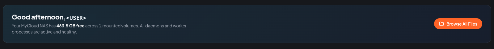
</p>

<p align="center">
  <strong>Turn an inexpensive Android TV box into a silent, ultra-low-power, 24/7 personal Network Attached Storage (NAS) server.</strong>
</p>

<p align="center">
  <a href="#features"></a>
  <a href="#requirements"></a>
  <a href="#system-architecture"></a>
  <a href="#step-11-secure-remote-access-via-cloudflare-zero-trust"></a>
  <a href="#license"></a>
</p>

---

## Table of Contents

- [Overview](#overview)
- [Key Features](#key-features)
- [System Architecture](#system-architecture)
  - [Service Port Matrix](#service-port-matrix)
  - [Storage Subsystem Architecture](#storage-subsystem-architecture)
- [Hardware & Software Prerequisites](#hardware--software-prerequisites)
  - [Hardware Requirements](#hardware-requirements)
  - [Software Requirements](#software-requirements)
- [Placeholder Reference Guide](#placeholder-reference-guide)
- [Step 1: Install & Set Up Termux](#step-1-install--set-up-termux)
- [Step 2: Grant Android Storage Permissions](#step-2-grant-android-storage-permissions)
- [Step 3: Discover & Mount External Drives](#step-3-discover--mount-external-drives)
- [Step 4: Configure Internal Storage FTP Server (`:1024`)](#step-4-configure-internal-storage-ftp-server-1024)
- [Step 5: Configure External Storage Root FTP Server (`:1025`)](#step-5-configure-external-storage-root-ftp-server-1025)
- [Step 6: Configure SSH Remote Terminal Administration (`:8022`)](#step-6-configure-ssh-remote-terminal-administration-8022)
- [Step 7: Automated Headless Boot with Termux:Boot](#step-7-automated-headless-boot-with-termuxboot)
- [Step 8: Connecting Client Devices to the NAS](#step-8-connecting-client-devices-to-the-nas)
  - [Method A: FileZilla Desktop GUI](#method-a-filezilla-desktop-gui)
  - [Method B: Windows File Explorer](#method-b-windows-file-explorer)
  - [Method C: Linux Desktop (GNOME Files / Dolphin)](#method-c-linux-desktop-gnome-files--dolphin)
  - [Method D: macOS Finder & Mobile Clients](#method-d-macos-finder--mobile-clients)
- [Step 9: Direct Media Streaming via FTP (VLC & Kodi)](#step-9-direct-media-streaming-via-ftp-vlc--kodi)
- [Step 10: MyCloud Web Dashboard & Media Portal (`:8090`)](#step-10-mycloud-web-dashboard--media-portal-8090)
  - [Web App Capabilities](#web-app-capabilities)
  - [Dashboard Overview](#dashboard-overview)
  - [Storage Drives View](#storage-drives-view)
  - [File Manager & Actions](#file-manager--actions)
  - [Photo Gallery](#photo-gallery)
  - [Profile & Account Settings](#profile--account-settings)
  - [Built-In Video Player](#built-in-video-player)
  - [Session Security](#session-security)
- [Step 11: Secure Remote Access via Cloudflare Zero Trust](#step-11-secure-remote-access-via-cloudflare-zero-trust)
  - [Remote Access Architecture](#remote-access-architecture)
  - [Local DNS Setup with `dnsmasq`](#local-dns-setup-with-dnsmasq)
  - [Cloudflare Private Routing & WARP Enrollment](#cloudflare-private-routing--warp-enrollment)
- [Step 12: Device Health & Administration Commands](#step-12-device-health--administration-commands)
- [Step 13: Comprehensive Troubleshooting Guide](#step-13-comprehensive-troubleshooting-guide)
- [Step 14: Security Hardening & Best Practices](#step-14-security-hardening--best-practices)
- [License](#license)

---

## Overview

Modern consumer NAS enclosures (Synology, QNAP) and x86 DIY servers (TrueNAS, Unraid) cost hundreds of dollars and consume 20W to 80W of continuous power. 

An Android TV box (such as the **X96 Mini**, TX3, Tanix, or any TV box powered by Amlogic S905W / S905X / Rockchip / Allwinner processors) is an ARM-based computer running Android with low power consumption (< 4 watts under load), passive silent cooling, and built-in USB ports.

This project transforms such devices into a complete personal NAS solution providing:
1. **High-speed LAN Storage Access** over dual FTP services.
2. **Dynamic External Disk Hot-Plugging** through Android's root `/storage` filesystem.
3. **Encrypted Remote Terminal Control** over OpenSSH.
4. **Automated Headless Bootstrapping** on system power-on via `Termux:Boot`.
5. **Modern Browser-Based File Manager & Media Portal** running directly on the TV box.
6. **Encrypted Worldwide Remote Access** using Cloudflare Zero Trust and WARP without opening router ports.

---

## Key Features

- **Multi-Drive Automatic Detection:** Plug in any USB flash drive, external SSD, or HDD; Android mounts it under `/storage/<UUID>/` and the FTP server exposes it automatically without editing config files.
- **Root-Level Read/Write Access:** Solves Android 7.x/8.x/9.x storage permission restrictions, providing full upload, rename, and delete capabilities on external disks.
- **Direct Byte-Range Media Streaming:** Stream 1080p and 4K movies directly in VLC, Kodi, or Nova Video Player without waiting for downloads.
- **Universal Client Support:** Connect seamlessly from Windows File Explorer, macOS Finder, Linux GNOME Files/Dolphin, FileZilla, and mobile file managers.
- **Zero Power Waste:** Idle power draw is under 2 watts, allowing continuous 24/7 operation at negligible electricity cost.
- **Web Interface:** Single-page web dashboard with audio streaming, video player, photo gallery, zip downloads, and profile customization.
- **Zero Port Forwarding Required:** Access your NAS from anywhere in the world through Cloudflare Zero Trust private network routing.

---

## System Architecture

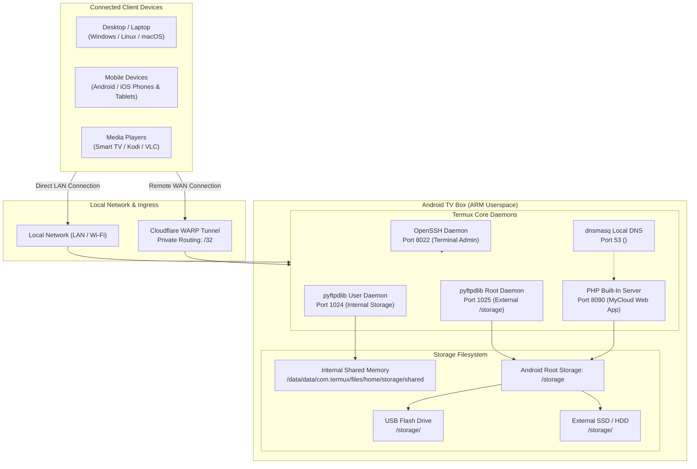

### Service Port Matrix

| Service | Protocol | Default Port | Execution User | Purpose |
|---|---|---|---|---|
| **SSH Management** | SSH / SCP | `8022` | Standard Termux (`<YOUR_TERMUX_USER>`) | Remote terminal administration, system monitoring, configuration |
| **Internal FTP** | Plain FTP | `1024` | Standard Termux (`<YOUR_TERMUX_USER>`) | Access Termux home directory and internal Android shared storage |
| **External FTP** | Plain FTP | `1025` | Superuser (`root`) | Unrestricted read/write access to all connected USB drives & SSDs |
| **MyCloud Web Portal** | HTTP | `8090` | Standard Termux (`<YOUR_TERMUX_USER>`) | Responsive web dashboard, file manager, media player, gallery |
| **Local DNS** | DNS | `53` | Superuser (`root`) | Local hostname resolution (`<YOUR_CUSTOM_HOSTNAME>`) |

### Storage Subsystem Architecture

```text
Android TV Storage
├── Internal User Flash
│   └── FTP :1024  --> ~/storage/shared  (/sdcard / /data/media/0)
│
└── Root Storage Mount Point (/storage)
    └── FTP :1025  --> /storage
        ├── <DRIVE_UUID_1>  --> e.g. 3CF3-E6B1 (64GB Flash Drive)
        │   ├── Documents/
        │   └── Backups/
        │
        ├── <DRIVE_UUID_2>  --> e.g. E4C69F59C69F2AB6 (1TB External SSD/HDD)
        │   ├── Movies/
        │   ├── TV_Shows/
        │   └── Music/
        │
        ├── emulated/0      --> Internal storage mirror
        └── self/primary    --> Primary user link
```

---

## Hardware & Software Prerequisites

### Hardware Requirements
- **Android TV Box:** Quad-Core ARM TV Box (e.g., Amlogic S905W / S905X / S912 / RK3328 / Allwinner H6) with 1 GB or 2 GB RAM.
- **Storage Disks:** USB flash drive, USB portable hard drive, or external SSD formatted in FAT32, exFAT, NTFS, or ext4.
- **Network:** 100 Mbps or Gigabit Ethernet connection (recommended for best stability) or 2.4/5 GHz Wi-Fi.
- **Root Privileges:** Root access (SuperSU, Magisk, or pre-rooted factory firmware) is **essential** for writing to external USB drives on Android 7.0+.

### Software Requirements
- **[Termux](https://f-droid.org/en/packages/com.termux/):** Terminal emulator and Linux userspace for Android (download APK from F-Droid or GitHub Releases; do **not** use the deprecated Google Play Store version).
- **[Termux:Boot](https://f-droid.org/en/packages/com.termux.boot/):** Termux companion app that triggers startup scripts when Android powers on.
- **OpenSSH:** Termux package for encrypted remote terminal access.
- **Python 3 & pyftpdlib:** Python environment and FTP library for serving storage.
- **PHP 8.x:** Lightweight CLI runtime for serving the optional MyCloud web dashboard.

---

## Placeholder Reference Guide

Throughout this guide, replace the following placeholders with your actual settings:

| Placeholder | Meaning / Description | Example Value |
|---|---|---|
| `<YOUR_NAS_IP>` | The local IPv4 address assigned to the Android TV box | `192.168.1.150` or `192.168.110.200` |
| `<YOUR_FTP_USERNAME>` | Username chosen for authenticating to FTP | `nasuser` or `tauhid` |
| `<YOUR_FTP_PASSWORD>` | Strong password chosen for FTP access | `MyStrongNASPass2026!` |
| `<YOUR_TERMUX_USER>` | Your Termux username on the TV box (from `whoami`) | `u0_a124` or `tauhid` |
| `<YOUR_DRIVE_UUID>` | Alphanumeric UUID of your mounted USB drive | `3CF3-E6B1` or `E4C69F59C69F2AB6` |
| `<YOUR_CUSTOM_HOSTNAME>`| Local private domain name for the NAS | `nas.home.arpa` or `tvbox.local` |
| `<YOUR_CLOUDFLARE_TEAM>`| Your Cloudflare Zero Trust organization name | `myorganization` |
| `<YOUR_AUTHORIZED_EMAIL>`| Authorized email address for Cloudflare WARP login | `user@example.com` |

---

## Step 1: Install & Set Up Termux

1. Download and install **Termux** from [F-Droid](https://f-droid.org/en/packages/com.termux/).
2. Launch Termux on the TV box (using a USB mouse, keyboard, or air-mouse remote).
3. Update package repositories and upgrade existing packages:
   ```bash
   pkg update && pkg upgrade -y
   ```
4. Install OpenSSH, Python, and DNS utilities:
   ```bash
   pkg install openssh python dnsutils -y
   ```
5. Install `pyftpdlib` using Python's package manager:
   ```bash
   pip install pyftpdlib
   ```
6. Verify that Python and pyftpdlib are installed correctly:
   ```bash
   python3 --version
   python3 -m pyftpdlib --help
   ```

> [!NOTE]
> Below is the expected terminal session output when completing package installation and verification:

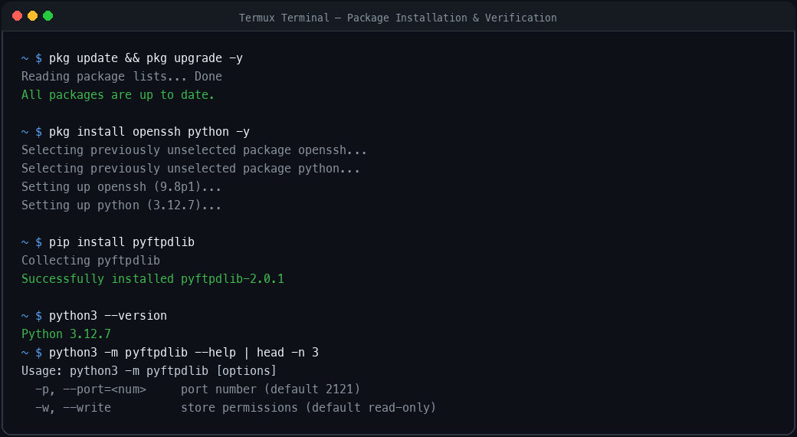

---

## Step 2: Grant Android Storage Permissions

Android isolates apps from user storage by default. You must grant Termux permission to access storage so it can link internal folders:

1. Run the storage configuration utility in Termux:
   ```bash
   termux-setup-storage
   ```
2. Android will prompt a system permission dialog on your TV screen:  
   *“Allow Termux to access photos, media, and files on your device?”*  
   Select **ALLOW**.

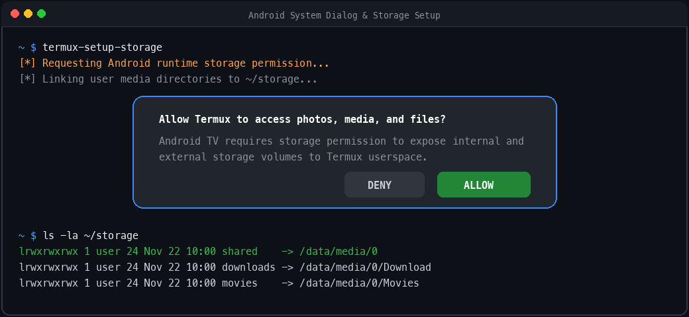

3. Verify that the storage symlinks were generated in your home folder:
   ```bash
   ls -la ~/storage
   ```
   You should see links pointing to common internal folders:
   - `shared` &rarr; `/sdcard` (internal storage root)
   - `downloads` &rarr; `/sdcard/Download`
   - `movies` &rarr; `/sdcard/Movies`
   - `pictures` &rarr; `/sdcard/Pictures`

---

## Step 3: Discover & Mount External Drives

Connect your USB flash drive, external SSD, or hard drive to one of the TV box's USB ports. Android automatically mounts external disks into subdirectories under `/storage/`.

1. Inspect the mounted disks in `/storage`:
   ```bash
   ls -la /storage
   ```
2. Check available partition sizes and mount points:
   ```bash
   df -h /storage/*
   ```

> [!TIP]
> The alphanumeric directory names (such as `3CF3-E6B1` or `E4C69F59C69F2AB6`) correspond to the unique Volume Serial / UUID assigned to your drive partition. These names remain consistent across reboots as long as the drive is not reformatted.

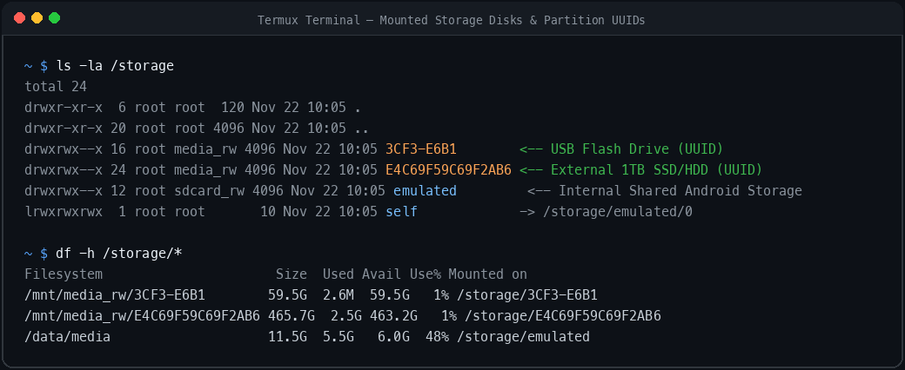

---

## Step 4: Configure Internal Storage FTP Server (`:1024`)

The internal storage FTP server runs in user space without requiring root privileges. It provides access to internal shared memory (`~/storage/shared`).

Run the following command to test the server interactively:

```bash
python3 -m pyftpdlib \
  -p 1024 \
  -w \
  -i <YOUR_NAS_IP> \
  -d "$HOME/storage/shared" \
  -u <YOUR_FTP_USERNAME> \
  -P <YOUR_FTP_PASSWORD>
```

### Parameter Reference:
- `-p 1024`: Binds the FTP server to port `1024` (ports below 1024 require root; 1024+ runs in user space).
- `-w`: Enables write permissions (upload, create folders, rename, delete).
- `-i <YOUR_NAS_IP>`: Binds the listener to your TV box's local network IP.
- `-d "$HOME/storage/shared"`: Sets the FTP root directory to Android shared storage.
- `-u <YOUR_FTP_USERNAME>`: Sets the authentication username.
- `-P <YOUR_FTP_PASSWORD>`: Sets the authentication password.

To stop the interactive server, press `Ctrl + C`.

---

## Step 5: Configure External Storage Root FTP Server (`:1025`)

On Android 7.0 and newer, standard Android sandbox rules prevent unprivileged applications from freely creating and modifying files on external USB disks. Running the external FTP daemon with superuser privileges (`su`) bypasses this restriction and grants unrestricted read and write capability.

By designating `/storage` as the FTP root, **all connected USB hard drives and flash drives are exposed automatically**.

Run the following command to start the external FTP server as a background daemon:

```bash
su -c 'setsid /data/data/com.termux/files/usr/bin/python3 \
  -m pyftpdlib \
  -p 1025 \
  -w \
  -i <YOUR_NAS_IP> \
  -d /storage \
  -u <YOUR_FTP_USERNAME> \
  -P <YOUR_FTP_PASSWORD> \
  >/data/local/tmp/ftp1025.log 2>&1 < /dev/null &'
```

### Verify the Daemon is Running:

Check that the server is actively listening on port 1025:
```bash
su -c 'ss -ltn | grep ":1025"'
```

Inspect active pyftpdlib processes:
```bash
pgrep -af pyftpdlib
```

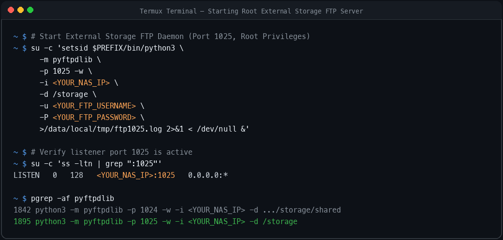

---

## Step 6: Configure SSH Remote Terminal Administration (`:8022`)

OpenSSH allows you to manage your Android TV NAS remotely from your computer without needing a screen or keyboard connected to the TV box.

1. Start the SSH daemon:
   ```bash
   sshd
   ```
2. Verify which user you are running as:
   ```bash
   whoami
   ```
   *(Note your Termux username, for example `<YOUR_TERMUX_USER>`)*
3. Set a password for your Termux user (if connecting via password):
   ```bash
   passwd
   ```
4. Verify that port 8022 is listening:
   ```bash
   ss -ltn | grep 8022
   ```

### Connecting from Your Computer:

Open your computer's terminal (Linux, macOS, or Windows PowerShell) and run:
```bash
ssh -p 8022 <YOUR_TERMUX_USER>@<YOUR_NAS_IP>
```

### Passwordless SSH Key Authentication (Recommended):
On your computer, copy your public key to the TV box to enable secure login without typing your password each time:
```bash
ssh-copy-id -p 8022 <YOUR_TERMUX_USER>@<YOUR_NAS_IP>
```

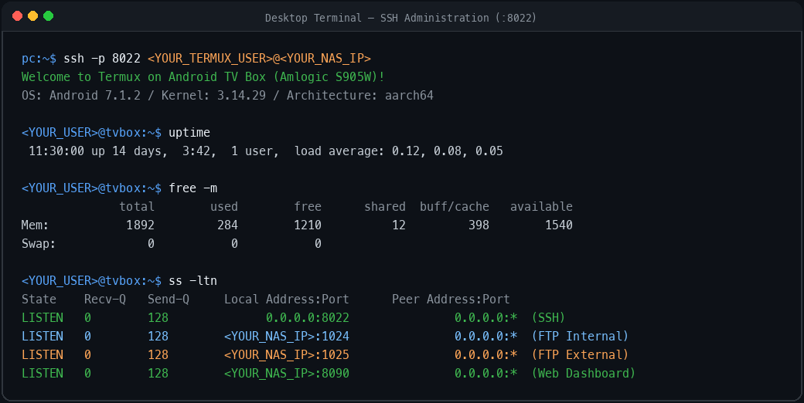

---

## Step 7: Automated Headless Boot with Termux:Boot

To ensure the NAS turns on automatically whenever power is connected to the TV box:

1. Install the **Termux:Boot** add-on APK from [F-Droid](https://f-droid.org/en/packages/com.termux.boot/).
2. Open the Termux:Boot app once from the Android TV app drawer so the system registers its boot broadcast receiver.
3. In Termux, create the boot scripts directory:
   ```bash
   mkdir -p ~/.termux/boot
   ```
4. Create the startup script `~/.termux/boot/start-nas`:
   ```bash
   nano ~/.termux/boot/start-nas
   ```
5. Paste the following production startup configuration:

```bash
#!/data/data/com.termux/files/usr/bin/sh

# 1. Acquire Android wake-lock to prevent CPU sleep
termux-wake-lock

# 2. Local FTP credentials (configured locally on TV box)
FTP_USER="<YOUR_FTP_USERNAME>"
FTP_PASS="<YOUR_FTP_PASSWORD>"

# 3. Wait for network interface to acquire a valid IPv4 address
for i in $(seq 1 30); do
    IP=$(ip -4 addr show eth0 2>/dev/null | awk '/inet / {print $2}' | cut -d/ -f1 | head -n1)
    [ -z "$IP" ] && IP=$(ip -4 addr show wlan0 2>/dev/null | awk '/inet / {print $2}' | cut -d/ -f1 | head -n1)
    if [ -n "$IP" ]; then
        break
    fi
    sleep 1
done

# If no IP address was acquired after 30 seconds, abort
[ -z "$IP" ] && exit 1

# 4. Start OpenSSH Daemon (Port 8022)
pgrep -x sshd >/dev/null 2>&1 || sshd

# 5. Start Internal Storage FTP (Port 1024)
if ! ss -ltn 2>/dev/null | grep -q ":1024 "; then
    nohup python3 -m pyftpdlib \
        -p 1024 \
        -w \
        -i "$IP" \
        -d "$HOME/storage/shared" \
        -u "$FTP_USER" \
        -P "$FTP_PASS" \
        >"$HOME/ftp1024.log" 2>&1 &
fi

# 6. Start Root External Storage FTP (Port 1025)
if ! ss -ltn 2>/dev/null | grep -q ":1025 "; then
    su -c "setsid $PREFIX/bin/python3 \
        -m pyftpdlib \
        -p 1025 \
        -w \
        -i $IP \
        -d /storage \
        -u '$FTP_USER' \
        -P '$FTP_PASS' \
        >/data/local/tmp/ftp1025.log 2>&1 < /dev/null &"
fi

# 7. Start MyCloud Web Portal (Port 8090, Optional)
if [ -d "$HOME/nas-app" ] && ! ss -ltn 2>/dev/null | grep -q ":8090 "; then
    export PHP_CLI_SERVER_WORKERS=8
    nohup php -d upload_max_filesize=2048M -d post_max_size=2048M -d memory_limit=512M \
        -S 0.0.0.0:8090 -t "$HOME/nas-app" >"$HOME/web8090.log" 2>&1 &
fi
```

6. Make the startup script executable:
   ```bash
   chmod +x ~/.termux/boot/start-nas
   ```
7. Test the script manually to confirm it starts all services cleanly:
   ```bash
   ~/.termux/boot/start-nas
   ```

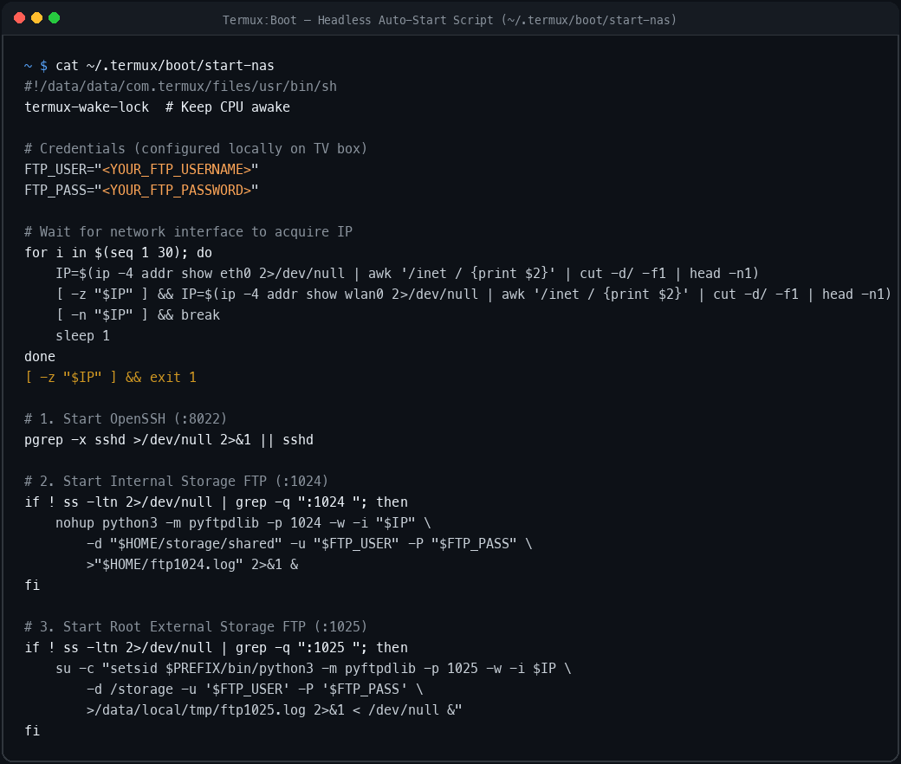

---

## Step 8: Connecting Client Devices to the NAS

### Method A: FileZilla Desktop GUI
FileZilla provides a visual dual-pane view for dragging and dropping files between your computer and the NAS.

1. Open FileZilla and open **File &rarr; Site Manager**.
2. Click **New Site** and enter:
   - **Protocol:** `FTP - File Transfer Protocol`
   - **Host:** `<YOUR_NAS_IP>` *(e.g. `192.168.1.100`)*
   - **Port:** `1025` *(for external USB/SSD drives)* or `1024` *(for internal storage)*
   - **Encryption:** `Only use plain FTP (insecure)`
   - **Logon Type:** `Normal`
   - **User:** `<YOUR_FTP_USERNAME>`
   - **Password:** `<YOUR_FTP_PASSWORD>`
3. Click **Connect**.

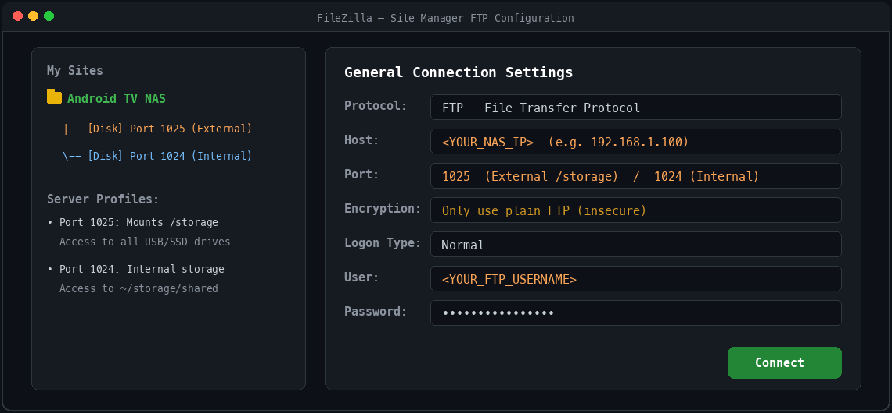

---

### Method B: Windows File Explorer
You can mount the NAS directly into Windows Explorer so it appears as a network folder:

1. Open **File Explorer** on Windows (`Win + E`).
2. Click in the location/address bar, type:
   ```text
   ftp://<YOUR_NAS_IP>:1025/
   ```
   and press **Enter**.
3. Right-click inside the blank space, select **Log On As...**, and enter your `<YOUR_FTP_USERNAME>` and `<YOUR_FTP_PASSWORD>`.
4. *To make it permanent:* Right-click **This PC** in the sidebar, select **Add a network location**, and enter `ftp://<YOUR_NAS_IP>:1025/`.

---

### Method C: Linux Desktop (GNOME Files / Dolphin)
1. Open your desktop file manager (**GNOME Files / Nautilus**, **KDE Dolphin**, or **Thunar**).
2. Press `Ctrl + L` to open the path bar.
3. Enter:
   ```text
   ftp://<YOUR_NAS_IP>:1025/
   ```
4. Enter your FTP credentials and select **Remember password**.
5. Bookmark the location in your sidebar for one-click access.

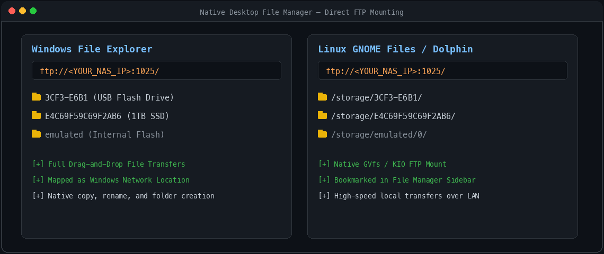

---

### Method D: macOS Finder & Mobile Clients
- **macOS Finder:** In Finder, click **Go &rarr; Connect to Server** (`Cmd + K`), enter `ftp://<YOUR_NAS_IP>:1025`, and authenticate. (For full write support on macOS, client apps such as [Cyberduck](https://cyberduck.io/) or [FileZilla](https://filezilla-project.org/) are recommended).
- **Android & iOS Devices:** Use apps like **Solid Explorer**, **Cx File Explorer**, or **Documents by Readdle**. Add a new connection, choose **FTP**, enter `<YOUR_NAS_IP>` and port `1025`, and connect over your home Wi-Fi.

---

## Step 9: Direct Media Streaming via FTP (VLC & Kodi)

Because `pyftpdlib` supports stream offsets and HTTP byte-range seeking, you do **not** need to download multi-gigabyte video or audio files to watch them.

### Playing in VLC Media Player:
1. Open VLC on your PC, phone, or Smart TV.
2. Select **Media &rarr; Open Network Stream** (or press `Ctrl + N`).
3. Enter the URL of the media file:
   ```text
   ftp://<YOUR_FTP_USERNAME>:<YOUR_FTP_PASSWORD>@<YOUR_NAS_IP>:1025/<YOUR_DRIVE_UUID>/Movies/Movie.mp4
   ```
4. Click **Play**. The video starts playing immediately with instant timeline seeking.

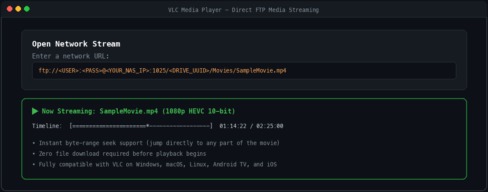

### Setting Up in Kodi:
1. Open Kodi and navigate to **Videos &rarr; Files &rarr; Add videos...**.
2. Click **Browse** and select **Add network location...**.
3. Choose **FTP server**, enter Server address `<YOUR_NAS_IP>`, Port `1025`, Remote path `/`, Username `<YOUR_FTP_USERNAME>`, and Password `<YOUR_FTP_PASSWORD>`.
4. Name the source `Android TV NAS` and save. Kodi will scrape metadata and display your movie posters automatically.

---

## Step 10: MyCloud Web Dashboard & Media Portal (`:8090`)

In addition to FTP, the NAS includes an integrated, zero-database **Single-Page Web Application (SPA)** written in pure PHP and vanilla JavaScript with PJAX navigation.

### Web App Capabilities
- **File Browser:** Upload files up to 2 GB, rename, move, delete, and download directories as `.zip` archives.
- **Integrated Video Player:** HTML5 video playback with resume-from-last-position, subtitle track support, and byte-range seeking.
- **Persistent Audio Player:** Background audio playback that continues uninterrupted while browsing other folders.
- **Responsive Photo Gallery:** High-resolution image viewer with thumbnail previews.
- **User Customization:** Change master password and upload custom profile avatars directly from the browser.
- **Zero-SQL Architecture:** State is persisted entirely in lightweight JSON files (`.nas_favorites.json`, `user_profile.json`, `.trash/`).

---

### Dashboard Overview
The main dashboard provides an instant status summary of mounted storage volumes, disk capacity, and daemon health:


---

### Storage Drives View
View all connected storage devices with partition UUIDs, filesystem types, and storage meters:

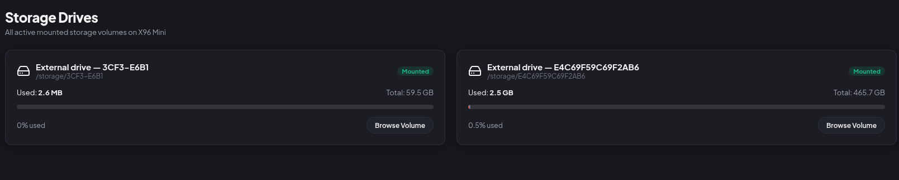

---

### File Manager & Actions
Browse files, perform batch selections, create directories, and download folders as zip archives:

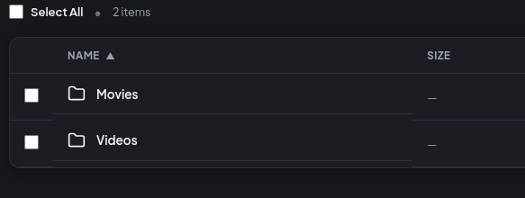

---

### Photo Gallery
Responsive photo gallery with lightbox view and instant photo uploads:

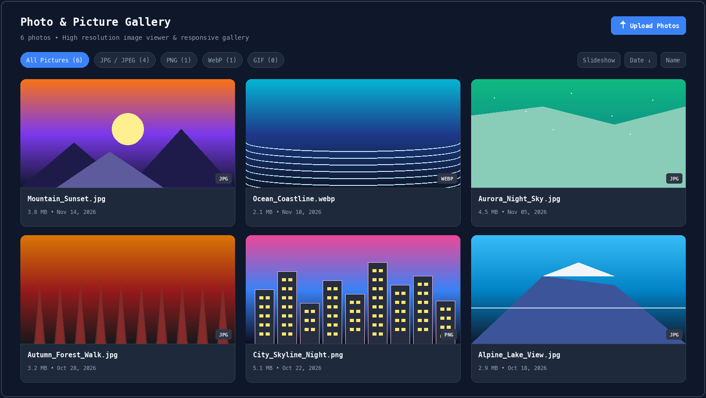

---

### Profile & Account Settings
Personalize your display name, upload a profile avatar, and securely update the administrative password:

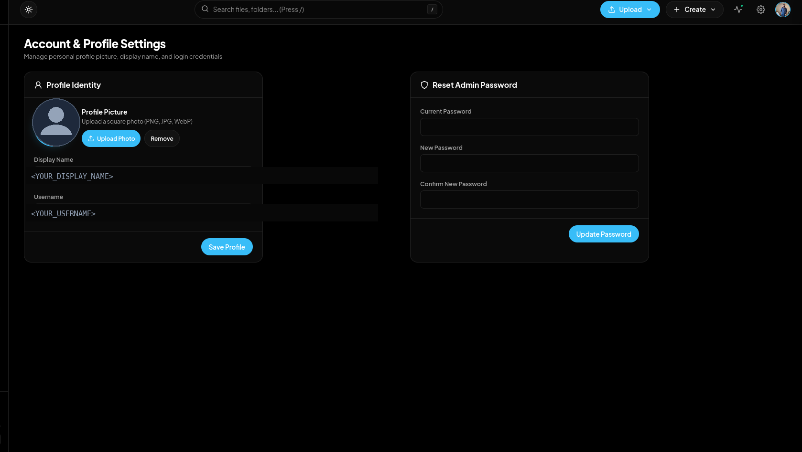

---

### Built-In Video Player
Stream movies directly inside any web browser with full playback control:

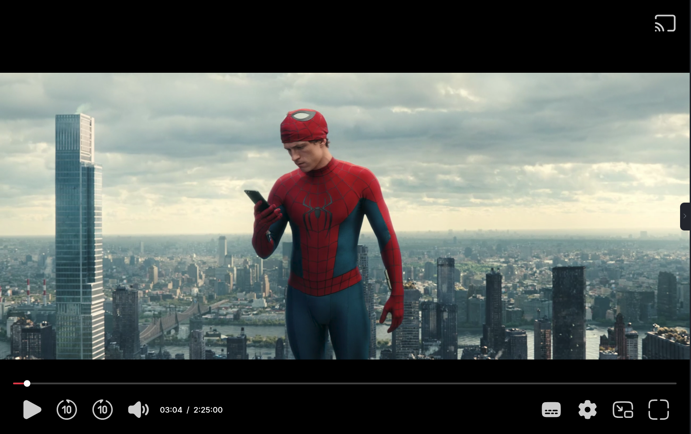

---

### Session Security
All sessions are protected with HTTPOnly cookies, strict session timeouts, and automatic CSRF defense:

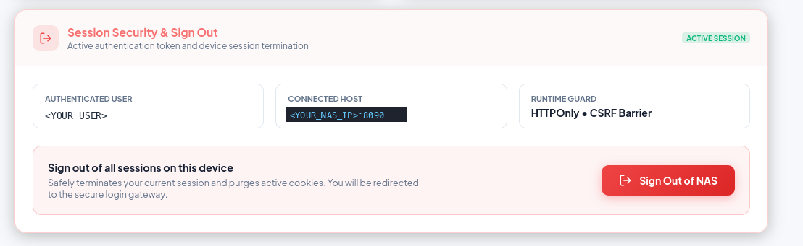

---

## Step 11: Secure Remote Access via Cloudflare Zero Trust

Opening router ports (port forwarding) exposes home devices to automated port scanners and brute-force botnets. 

Instead, this setup uses **Cloudflare Zero Trust + WARP** to create an encrypted, outbound-only tunnel. Your NAS remains invisible to the public internet while remaining accessible to your authorized devices from anywhere in the world.

### Remote Access Architecture

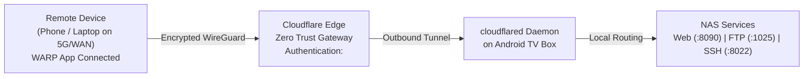

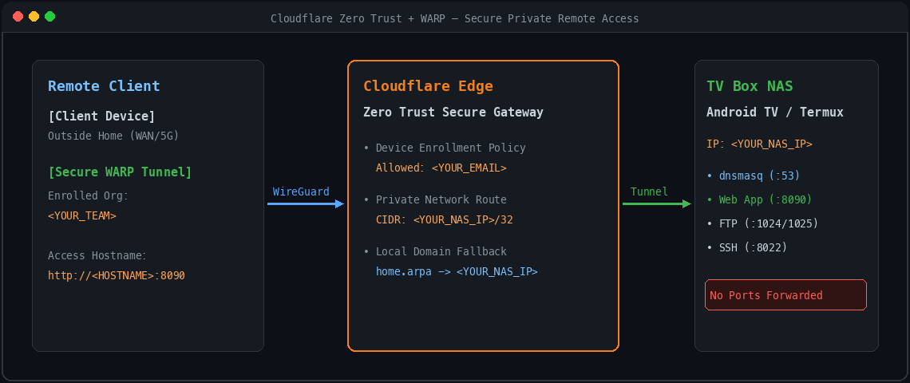

---

### Local DNS Setup with `dnsmasq`

To resolve the friendly domain `<YOUR_CUSTOM_HOSTNAME>` (e.g. `nas.home.arpa`) without purchasing a public domain name, run `dnsmasq` locally on the TV box:

1. Install `dnsmasq`:
   ```bash
   pkg install dnsmasq
   ```
2. Create configuration file `$PREFIX/etc/dnsmasq-nas.conf`:
   ```ini
   # Private NAS DNS Configuration
   port=53
   listen-address=<YOUR_NAS_IP>
   bind-interfaces
   no-resolv
   no-hosts

   # Route friendly hostname to NAS local IP
   address=/<YOUR_CUSTOM_HOSTNAME>/<YOUR_NAS_IP>
   local=/home.arpa/
   cache-size=100
   ```
3. Test and start the DNS service:
   ```bash
   su -c "$PREFIX/bin/dnsmasq --test --conf-file=$PREFIX/etc/dnsmasq-nas.conf"
   su -c "$PREFIX/bin/dnsmasq --conf-file=$PREFIX/etc/dnsmasq-nas.conf"
   ```
4. Verify DNS resolution:
   ```bash
   dig @<YOUR_NAS_IP> <YOUR_CUSTOM_HOSTNAME>
   ```

---

### Cloudflare Private Routing & WARP Enrollment

1. **Create Cloudflare Tunnel:**
   In [Cloudflare Zero Trust Dashboard](https://one.dash.cloudflare.com/), navigate to **Networks &rarr; Tunnels** and create a tunnel (e.g. `<YOUR_TUNNEL_NAME>`).
2. **Add Private Network Route:**
   Under your tunnel configuration, add a Private Network Route:
   - **CIDR:** `<YOUR_NAS_IP>/32`
3. **Configure Local Domain Fallback:**
   In **Settings &rarr; WARP Client &rarr; Device Settings &rarr; Default profile &rarr; Local Domain Fallback**, add:
   - **Domain:** `home.arpa`
   - **DNS Server:** `<YOUR_NAS_IP>`
4. **Authorize Devices:**
   In **Settings &rarr; WARP Client &rarr; Device enrollment permissions**, add your email `<YOUR_AUTHORIZED_EMAIL>` to the allowed list.
5. **Connect from Remote Device:**
   - Install the **Cloudflare One / WARP** app on your phone or laptop.
   - Log in using your team name `<YOUR_CLOUDFLARE_TEAM>` and verify with the One-Time PIN sent to your email.
   - Turn on WARP.
   - Open your browser and navigate to:
     ```text
     http://<YOUR_CUSTOM_HOSTNAME>:8090
     ```
     You are now securely connected to your home NAS from anywhere in the world!

---

## Step 12: Device Health & Administration Commands

Useful diagnostic commands to run from an SSH session:

```bash
# Check filesystem storage usage across all mounted drives
df -h /storage/*

# Check RAM consumption and buffer memory
free -m

# Check CPU core temperature (in milli-degrees Celsius)
cat /sys/class/thermal/thermal_zone0/temp 2>/dev/null | awk '{print $1/1000 " °C"}'

# Monitor active network connections and listening ports
ss -tunp

# Monitor running Python, SSH, and PHP processes
ps aux | grep -E 'python|sshd|php'

# Inspect FTP server logs in real time
tail -f ~/ftp1024.log
su -c 'tail -f /data/local/tmp/ftp1025.log'
```

---

## Step 13: Comprehensive Troubleshooting Guide

### 1. FTP Port is Not Listening
- Verify whether the process is alive: `pgrep -af pyftpdlib`
- Check log files for syntax or binding errors: `cat ~/ftp1024.log` or `su -c 'cat /data/local/tmp/ftp1025.log'`
- Ensure the IP address specified in `-i` matches your current IP (`ip -4 addr`).

### 2. External FTP Cannot Upload or Delete Files
- External drive write operations on Android require root. Ensure port 1025 is started via `su -c`.
- Check if the drive is mounted read-only (`ro`):
  ```bash
  mount | grep /storage
  ```
  If mounted `ro`, unmount and reconnect the drive, or run a filesystem check on a PC (`chkdsk` on Windows or `fsck` on Linux).

### 3. Drive Disappears After TV Goes to Standby
- Some Android TV firmware puts USB ports into low-power sleep when the TV screen turns off.
- In Android TV Settings: **Device Preferences &rarr; Power &rarr; Sleep Mode / Energy Saver** &rarr; Set to **Never**.
- In Developer Options: Enable **Stay awake** (screen will not sleep while charging/powered).
- Ensure `termux-wake-lock` is executed in `start-nas`.

### 4. IP Address Changes After Router Reboot
- When using standard DHCP, the router may assign a different IP address to the TV box.
- **Solution:** Open your home Wi-Fi router settings and assign a **Static DHCP Reservation** bound to the TV box's MAC address (e.g. reserve `<YOUR_NAS_IP>`).

### 5. SSH Connection Refused
- Confirm `sshd` is running: `pgrep -x sshd`
- Check listening port: `ss -ltn | grep 8022`
- Remember Termux OpenSSH listens on port **8022**, not the default Linux port 22.

---

## Step 14: Security Hardening & Best Practices

1. **Never Forward FTP Ports on Your Router:** FTP transmits credentials and file data in cleartext. Keep FTP restricted to your local network or access it remotely through an encrypted VPN / Cloudflare WARP tunnel.
2. **Use Key-Based SSH Authentication:** Disable password authentication in `$PREFIX/etc/ssh/sshd_config` once your SSH public key is installed.
3. **Bcrypt Password Hashes for Web Dashboards:** Never store plaintext passwords in configuration files. Store Bcrypt hashes generated via `password_hash()`.
4. **Isolated Guest VLAN:** If your router supports multi-SSID VLANs, place the NAS and trusted family devices on an isolated VLAN separated from untrusted IoT appliances.
5. **Clean Shutdown:** Avoid abruptly pulling the TV box power cable while writing large files. Always issue `su -c sync` or unmount disks cleanly when possible.

---

## License

This project is open-source software licensed under the [MIT License](LICENSE). Feel free to adapt and share!
